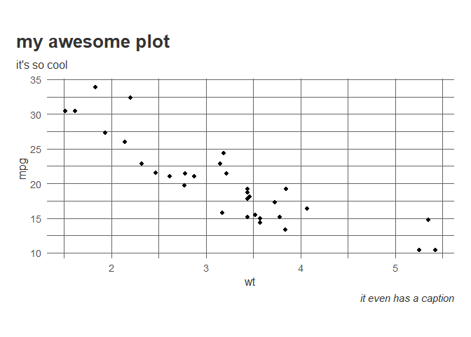
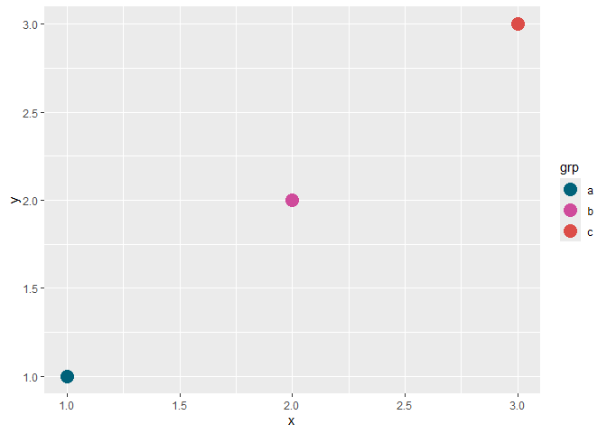
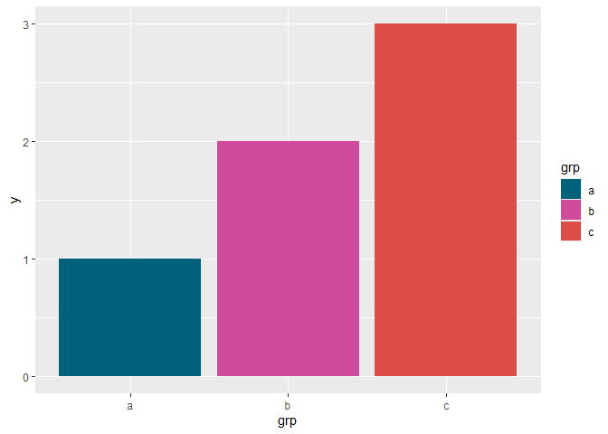

<!-- README.md is generated from README.qmd. Please edit that file -->

# ccpsplot

<!-- badges: start -->


[](https://github.com/ccps-research-eval/ccpsplot/actions/workflows/R-CMD-check.yaml)
[](https://app.codecov.io/gh/ccps-research-eval/ccpsplot)
<!-- badges: end -->

`{ccpsplot}` provides R plotting utilities for CCPS. Currently, it
provides two general utilities:

- a minimalist ggplot theme (`theme_ore()`);
- color palettes and ggplot scales that use the official CCPS “school
  board” colors.

## Installation

You can install the development version of ccpsplot from Github with:

``` r
# install.packages("pak")
pak::pak("ccps-research-eval/ccpsplot")
```

## Usage

### ggplot theme

Apply `theme_ore()` to a ggplot object in the usual fashion:

``` r
library(ggplot2)
#> Warning: package 'ggplot2' was built under R version 4.5.3
library(ccpsplot)

ggplot(mtcars, aes(x = wt, y = mpg)) +
    geom_point() +
    labs(
        title = "my awesome plot",
        subtitle = "it's so cool",
        caption = "it even has a caption"
    ) +
    theme_ore()
```



### custom colors

We can apply custom ggplot color/fill palettes like so:

``` r
z <- data.frame(
    grp = c("a", "b", "c"),
    x = 1:3,
    y = 1:3
)

ggplot(z, aes(x, y, color = grp)) +
    geom_point(size = 5) +
    scale_color_schoolboard()
```



``` r
ggplot(z, aes(grp, y, fill = grp)) +
    geom_col() +
    scale_fill_schoolboard()
```


